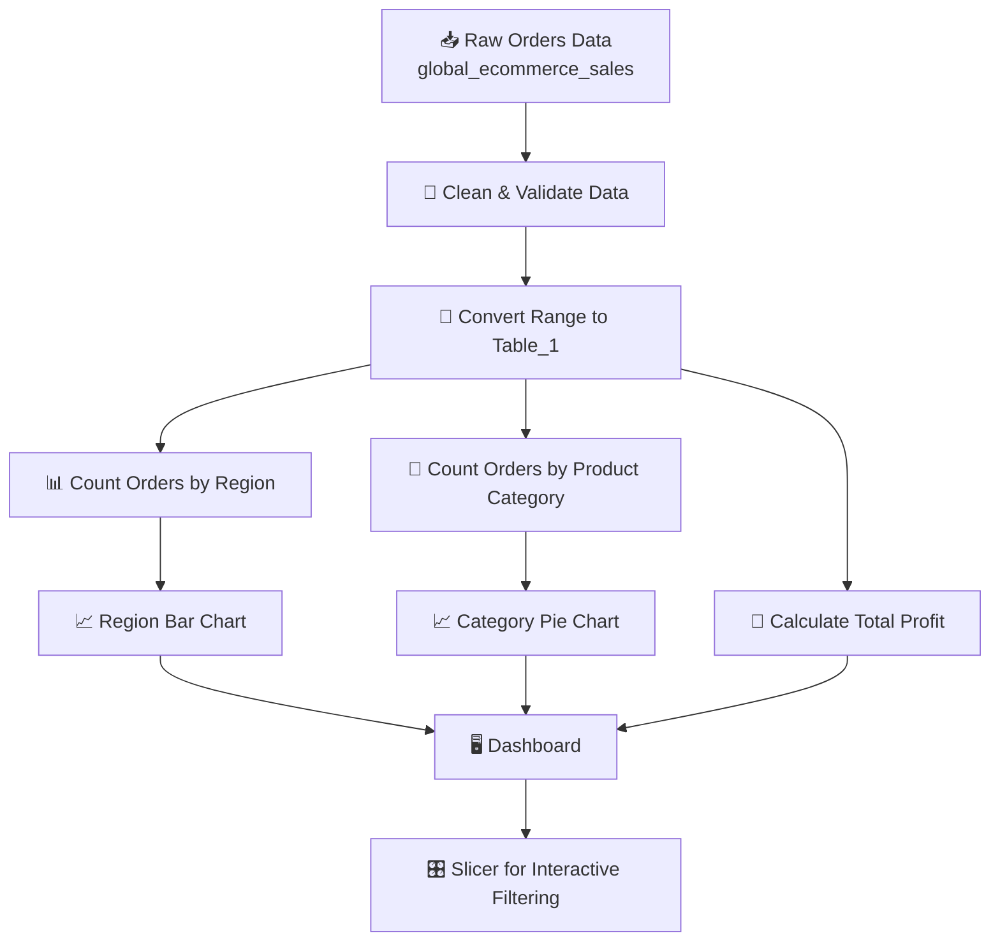

[README (16).md](https://github.com/user-attachments/files/34310133/README.16.md)
Analyzer

🔗 **Project File:** [Open on Google Drive](https://drive.google.com/file/d/1dYDOGRVKMEoKeJyJ7Y0v1lWrXJHJX_Ks/view?usp=sharing)

---

<div align="center">

# 🌍 Global E-Commerce Sales Analysis & Dashboard

### Cleaning, summarising and visualising 210 worldwide orders with spreadsheets


</div>

---

## 📑 Table of Contents

1. [Problem Statement](#-problem-statement)
2. [Objectives](#-objectives)
3. [Dataset Description](#-dataset-description)
4. [Technologies Used](#-technologies-used)
5. [Programme Flow](#-programme-flow)
6. [Output Screenshots](#-output-screenshots)
7. [Key Insights](#-key-insights)
8. [Project Structure](#-project-structure)
9. [Author](#-author)

---

## ❓ Problem Statement

A global e-commerce company sells **Technology, Furniture, Office Supplies and Clothing & Accessories** to customers across **5 regions**. Order records are stored in a single raw sheet, which makes it hard to answer simple business questions:

- Which **region** places the most orders?
- Which **product category** sells the most?
- How much **sales and profit** does the business make overall?
- Are there **data-quality issues** (loss-making orders, wrong values, stray cells) that need fixing first?

This project turns the raw order sheet into a clean table and an interactive **dashboard** that answers these questions at a glance.

<div align="center">


<sub>📊 Orders per region – the first question the dashboard answers</sub>

</div>

---

## 🎯 Objectives

- ✅ **Clean and organise** the raw order data into a structured table (`Table_1`).
- ✅ **Summarise orders by Region** to find the strongest markets.
- ✅ **Summarise orders by Product Category** to find the best-selling segments.
- ✅ **Calculate total profit** across all orders.
- ✅ **Highlight data-quality problems** (negative sales value, loss-making orders, extra helper cells).
- ✅ **Build a dashboard** with charts and a **slicer** for quick filtering.

<div align="center">


<sub>🥧 Share of orders by product category – objective #3 in action</sub>

</div>

---

## 🗂️ Dataset Description

| Item | Details |
|------|---------|
| **Sheet name** | `global_ecommerce_sales` |
| **Records** | 210 orders |
| **Date range** | 02 Jan 2023 → 11 May 2023 |
| **Regions** | North America, Europe, Asia Pacific, South America, Middle East & Africa |
| **Categories** | Technology, Furniture, Office Supplies, Clothing & Accessories |
| **Total Sales** | 57,757.23 |
| **Total Profit** | 19,812.56 |

### 🧾 Columns

| Column | Description |
|--------|-------------|
| `Customer_ID` | Unique order reference (e.g. `ORD-11121`) |
| `Order_Date` | Date the order was placed |
| `Customer_Name` | Name of the customer |
| `Region` | Sales region |
| `Product_Category` | Category of product purchased |
| `Quantity` | Number of units ordered |
| `Discount` | Discount given (%) |
| `Sales` | Sales amount of the order |
| `Profit` | Profit earned on the order |

---

## 🛠️ Technologies Used

<div align="center">

| Technology | Purpose |
|:----------:|:--------|
| 📗 **Google Sheets** | Data entry, cleaning and dashboard creation |
| 📘 **Microsoft Excel (.xlsx)** | Final workbook format for sharing |
| 🧮 **Formulas** (`SUM`, `COUNT`) | Total profit and category/region counts |
| 📊 **Charts** (Bar, Pie, Line) | Visualising regions, categories and order dates |
| 🎛️ **Slicer / Filter Views** | Interactive filtering on the dashboard |
| 🎨 **Conditional Formatting** | Highlighting cells that need attention |
| 🧱 **Tables** | Structuring the raw data (`Table_1`) |

</div>

---

## 🔄 Programme Flow



### Step-by-step

| Step | What happens | Output |
|:----:|--------------|--------|
| **1** | Import the raw order data into the `global_ecommerce_sales` sheet | 210 order rows |
| **2** | Check data quality – blank cells, negative values, stray text | Issues identified |
| **3** | Convert the data range `A1:J212` into a table (`Table_1`) and add filters | Structured table |
| **4** | Calculate **Total Profit** with a formula | **19,812.56** |
| **5** | Count orders per **Region** and plot a horizontal bar chart | See image below 👇 |
| **6** | Count orders per **Product Category** and plot a pie chart | See image below 👇 |
| **7** | Place charts and a **slicer** on the `Dashboard` sheet | Interactive dashboard |

**Step 5 output – Region chart**


**Step 6 output – Category chart**


---

## 🖼️ Output Screenshots

<table>
  <tr>
    <td align="center"><b>📊 Count of Orders by Region</b></td>
    <td align="center"><b>🥧 Count of Orders by Product Category</b></td>
  </tr>
  <tr>
    <td></td>
    <td></td>
  </tr>
</table>

### 📋 Order Counts

| Region | Orders |
|--------|:------:|
| 🌏 Asia Pacific | 61 |
| 🌎 North America | 59 |
| 🌍 Europe | 43 |
| 🌍 Middle East & Africa | 25 |
| 🌎 South America | 22 |

| Product Category | Orders | Share |
|------------------|:------:|:-----:|
| 💻 Technology | 60 | 28.6% |
| 📎 Office Supplies | 57 | 27.1% |
| 🪑 Furniture | 50 | 23.8% |
| 👕 Clothing & Accessories | 43 | 20.5% |

---

## 💡 Key Insights

- 🏆 **Asia Pacific (61)** and **North America (59)** together place more than half of all orders.
- 💰 **North America** earns the highest sales (15,668) and profit (5,669).
- 🪑 **Furniture** drives about **56% of total sales** (32,529) even though it has fewer orders than Technology or Office Supplies.
- 📎 **Office Supplies** has many orders (57) but the lowest sales (2,090) and profit (358) – small ticket size, thin margin.
- 📈 Overall profit margin is about **34%** (19,812.56 profit on 57,757.23 sales).
- ⚠️ **29 orders are loss-making**, and one order has a **negative sales value (-122)** which should be reviewed as a data-entry error.

---

## 📁 Project Structure

```
📦 Global-Ecommerce-Sales-Dashboard
 ┣ 📂 images
 ┃ ┣ 🖼️ region_orders_chart.png
 ┃ ┗ 🖼️ product_category_chart.png
 ┣ 📊 Tirth_4.xlsx
 ┗ 📄 README.md
```

The workbook contains these sheets:

| Sheet | Purpose |
|-------|---------|
| `global_ecommerce_sales` | Raw data table + total profit + chart images |
| `Dashboard` | Region & category charts with a slicer |
| `Dashboard 1` | Additional chart view |

---

## 👨‍💻 Author

<div align="center">

**Tirth**

📊 Data Analysis • Spreadsheets • Dashboards

[](https://drive.google.com/file/d/1dYDOGRVKMEoKeJyJ7Y0v1lWrXJHJX_Ks/view?usp=sharing)

</div>

---

<div align="center">

⭐ *If you found this project useful, please give it a star!* ⭐

</div>
